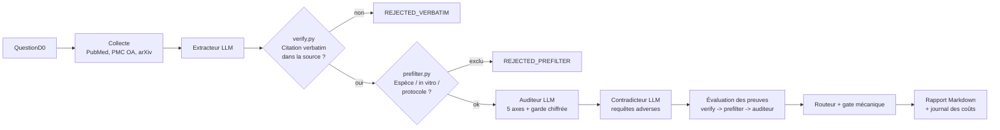

# Mêtis D0 — Orchestrateur multi-agents d'audit documentaire à garde-fous déterministes

[](https://github.com/NikoGandon/metis-d0/actions/workflows/ci.yml)
[](https://www.python.org/downloads/)
[](https://mypy-lang.org/)
[](LICENSE)

Orchestrateur multi-agents en Python où **les agents LLM proposent et des règles hors LLM décident**.
Chaque citation extraite de PubMed, PMC Open Access ou arXiv est vérifiée **mot pour mot** dans le document source avant tout jugement sémantique ; sinon, elle est refusée.

> **Périmètre de ce dépôt** : implémentation complète, testée et exécutable de **D0 (audit documentaire)**, avec son harnais d'évaluation (64 cas, cassettes rejouables sans réseau), son API FastAPI et son packaging Docker. La partie **D1 (Forge d'outils en sandbox)** reste en développement privé.

---

## Architecture



Principes d'ingénierie :
- **Flux de contrôle déterministe en Python** (pas de LangGraph) : chaîne explicite d'étapes `EtatD0 -> EtatD0`, persistée atomiquement après chaque étape (`metis/pipeline/cycle_d0.py`).
- **Garde-fous hors LLM** : un modèle peut proposer une citation ou un jugement, jamais contourner une porte mécanique ni forcer une transition d'état.
- **Fail-closed par défaut** : sortie hors schéma, refus de modération du fournisseur ou plafond de budget atteint → rejet tracé, jamais de contournement silencieux.

Détails complets : [docs/architecture.md](docs/architecture.md) et [docs/decisions.md](docs/decisions.md).

---

## Garde-fous implémentés

| Garde-fou | Module | Hors LLM |
| :--- | :--- | :---: |
| Vérification verbatim & table d'offsets Unicode | `metis/literature/verify.py` | **oui** |
| Pré-filtres lexicaux (espèces animales, *in vitro*, protocoles futurs) | `metis/literature/prefilter.py` | **oui** |
| Garde chiffrée sur les protocoles futurs (rejette `ESTABLISHED` sans `p`, `IC`/`CI`, `HR`/`OR`/`RR`/`MD`) | `metis/pipeline/auditeur.py` | **oui** |
| Schémas Pydantic gelés (`frozen=True`, `extra="forbid"`) & machine à états vérifiée | `metis/schemas.py` | **oui** |
| Invariant vérifié par AST : seul l'auditeur peut établir un claim | `tests/test_cycle_d0.py` | **tests** |
| Plafond de budget pré-appel (borne supérieure réservée avant envoi) & journal atomique | `metis/llm.py` (`RunLedger`) | **oui** |
| Refus fournisseur (`content_filter` / `refusal`) : aucun retry, fail-closed et mesuré | `metis/llm.py` | **oui** |
| Red-teaming & property-based testing (`hypothesis`) | `tests/test_red_team_critic.py`, `tests/test_verify_prefilter.py` | **tests** |

---

## Résultats d'évaluation (gold set de 64 cas)

Le harnais [evals/run_evals.py](evals/run_evals.py) compare les juges D0 sur **64 cas réels** tirés de PubMed ([evals/gold_d0.jsonl](evals/gold_d0.jsonl) — 61 mesurés, 3 cas ambigus isolés, 12 catégories piégeuses : transposition animale, *in vitro*, mesurande/population/intervention voisins, protocole sans résultat, spéculation, plan observationnel, fausses et vraies réfutations).

| Métrique | `anthropic/claude-opus-5.5` (64/64) | `qwen/qwen3.8-max-0902` (41/64) |
| :--- | :---: | :---: |
| **Exactitude globale** | **90,2 %** (55/61) | **75,6 %** (31/41) |
| **Exactitude hors refus fournisseur** | **93,8 %** (45/48) | **75,6 %** (31/41) |
| **Taux de faux `ESTABLISHED`** *(seuil d'alerte < 5 %)* | **2,5 %** (1 cas : cohorte observationnelle) | **0,0 %** |
| **Faux rejets sur claims valides** *(précision > rappel)* | **40,0 %** (**25,0 %** hors refus API) | **87,5 %** |
| **Faux rejets du pré-filtre déterministe** | **0,0 %** (8 cas filtrés sans appel LLM) | **0,0 %** |
| **Contradicteur** *(fausses confirmées / vraies manquées)* | **0,0 %** / **0,0 %** | *non atteint (arrêt budget)* |
| **Refus fournisseur (modération API)** | **23,2 %** (13/56 appels ; **52 %** sur sujets sensibles, 0 % ailleurs) | **0,0 %** |
| **Sorties hors schéma (`juge_sortie_invalide`)** | **0** | **22/41** (53,7 %) |
| **Coût du run** | **1,26 USD** (56 appels) | **0,89 USD** (60 appels — stoppé sous plafond **0,90 USD**) |

Rapports complets : [evals/rapport_2026-11-04_opus.json](evals/rapport_2026-11-04_opus.json) et [evals/rapport_2026-11-04_qwen.json](evals/rapport_2026-11-04_qwen.json).

**Enseignements clés mesurés** :
1. **Fail-closed validé en conditions dégradées (`Qwen`)** : malgré 53,7 % de sorties non conformes au schéma, le taux de faux `ESTABLISHED` reste à **0,0 %**, et le garde-fou de budget a coupé le run avant dépassement (`0,8858 $ + 0,0280 $ max > 0,90 $`).
2. **Compromis assumé : précision avant le rappel (`Opus`)** : le système rejette 40 % des claims valides (25 % hors refus API — cas où la population ou le mesurande n'est pas entièrement démontré dans le contexte), en échange d'un seul faux `ESTABLISHED` (2,5 %). En audit documentaire, un faux positif est plus coûteux qu'un rejet prudent.
3. **Détection d'un biais de modération API (`Opus`)** : sur les 13 refus de modération d'Opus sur sujets biomédicaux sensibles, **10 tombaient par hasard sur un cas à rejeter** (`nb_correct_par_refus = 10`). Séparer `exactitude_globale` et `exactitude_hors_refus` évite de sur-évaluer un modèle qui censure.
4. **Économie du pré-filtre** : 8 cas sur 64 (12,5 %) sont filtrés avant tout appel LLM avec **0 % de faux rejets**.

> **Limite méthodologique** : les 64 étiquettes de `evals/gold_d0.jsonl` ont été proposées par Claude (*« proposition Claude, à valider par l'opérateur »*) et n'ont pas encore été validées manuellement (`cas_valides_par_humain: 0`). Ces chiffres mesurent la cohérence du pipeline sur ce jeu interne, et non une vérité terrain validée par un humain ni une garantie clinique générale.

---

## Démarrage rapide (0 USD, hors réseau)

### 1. Tests, typage strict et rejeu d'évaluations

```bash
python3 -m venv .venv
.venv/bin/pip install -e ".[dev]"

# Suite complète (tests unitaires, hypothesis, red-teaming, cycle D0 complet, API)
# Réseau coupé automatiquement par tests/conftest.py — mode replay, 0 USD
.venv/bin/pytest -v

# Vérification statique stricte (mypy --strict + plugin Pydantic)
.venv/bin/mypy --strict metis

# Recalcul des métriques d'évaluation depuis les cassettes enregistrées (0 USD)
.venv/bin/python evals/run_evals.py --recalculer --juges anthropic/claude-opus-5.5
```

### 2. API FastAPI & Docker Compose (démo rejouable sans clé API)

```bash
docker compose up --build
# Swagger UI disponible sur http://localhost:8000/docs
```

Ou en local sans Docker :

```bash
.venv/bin/uvicorn metis.api:app --reload
```

Endpoints exposés :
- `GET /health` : état du service, mode cassette, modèle configuré, versions des lexiques.
- `POST /v1/verify` : exécute les portes déterministes (`verify.py` + `prefilter.py`, **0 LLM**) sur n'importe quel couple `(source_text, citation)`.
- `POST /v1/audit/demo` : rejoue un **cycle D0 complet** (collecte PubMed figée → extraction → vérification → audit → réfutation → routage → rapport Markdown) en mode `replay` (**0,00 USD**, aucun appel réseau).
- `GET /v1/evals` : expose la synthèse JSON des rapports d'évaluation mesurés (`Opus` vs `Qwen`).

Exemple `curl` sur les portes déterministes :

```bash
curl -s -X POST http://localhost:8000/v1/verify \
  -H "Content-Type: application/json" \
  -d '{
    "source_id": "pmid:22892342",
    "source_text": "In a second study, female mice were pair-fed 30% EtOH diets with or without dietary supplementation.",
    "citation": "In a second study, female mice were pair-fed 30% EtOH diets with or without",
    "espece_cible": "human_in_vivo"
  }'
# -> {"statut": "REJECTED_PREFILTER", "verbatim_ok": true, "motif_rejet": "espece_exclue_sans_marqueur_humain: mice", ...}
```

---

## Exécution live gratuite avec un modèle local (Ollama / serveur compatible OpenAI)

En plus d'OpenRouter (`OPENROUTER_API_KEY`), `metis/llm.py` accepte tout serveur compatible OpenAI sur un hôte local (`localhost`, `127.0.0.1`, `::1`, `host.docker.internal`) avec un modèle préfixé `ollama/` ou `local/` (tarif explicite `0,00 USD`, aucune clé API requise) :

```bash
export METIS_CASSETTE=live
export METIS_LLM_BASE_URL=http://127.0.0.1:11434/v1/chat/completions
export METIS_MODEL_JUDGE=ollama/qwen2.5:7b
```

Pour un modèle distant (OpenRouter), tout modèle absent de `TABLE_PRIX` lève `UnknownModelPricingError` avant le moindre appel et l'absence de `OPENROUTER_API_KEY` lève `CleApiManquanteError` (*fail-closed*).

---

## Variables d'environnement principales

| Variable | Rôle | Défaut |
| :--- | :--- | :--- |
| `METIS_CASSETTE` | `live`, `replay`, `record` ou `record_missing` | `live` (`replay` forcé sous `pytest` et Docker) |
| `METIS_CASSETTE_DIR` | Dossier des cassettes JSON | `tests/fixtures/cassettes` |
| `METIS_MODEL_JUDGE` | Modèle des juges (`extracteur`, `auditeur`, `contradicteur`, `routeur`) | `anthropic/claude-opus-5.5` |
| `METIS_MODEL_<ROLE>` | Surcharge par rôle (`EXTRACTEUR`, `AUDITEUR`, `CONTRADICTEUR`, `ROUTEUR`) | `METIS_MODEL_JUDGE` |
| `METIS_LLM_BASE_URL` | Endpoint OpenAI-compatible (OpenRouter ou Ollama/vLLM local) | `https://openrouter.ai/api/v1/chat/completions` |
| `OPENROUTER_API_KEY` | Clé OpenRouter (requise hors hôte local en mode `live`/`record`) | — |
| `METIS_BUDGET_USD` | Plafond de budget pré-appel par run | `10` |

---

## Contact

Nikola Gandon — [LinkedIn](https://www.linkedin.com/in/nikola-gandon/) · [GitHub](https://github.com/NikoGandon)
